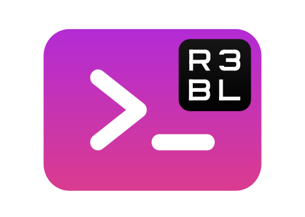

<p align="center">
  
</p>

# 🎨 Contributing to r3bl-open-core

Thank you for considering contributing to `r3bl-open-core`! We welcome contributions from
everyone, regardless of your level of experience.

<!-- TOC -->

- [Code of Conduct](#code-of-conduct)
- [Getting Started](#getting-started)
- [Branch Naming](#branch-naming)
- [Commit Message Guidelines](#commit-message-guidelines)
- [Local Development and Checks](#local-development-and-checks)
- [Submitting a Pull Request](#submitting-a-pull-request)
- [Reporting Issues and Feature Requests](#reporting-issues-and-feature-requests)
- [Design and Engineering Philosophy](#design-and-engineering-philosophy)
- [License](#license)

<!-- /TOC -->

## Code of Conduct

All contributors are expected to adhere to the
[Rust Code of Conduct](https://www.rust-lang.org/policies/code-of-conduct) in all
interactions related to this project.

## Getting Started

1. **Find an Issue**: Browse issues tagged
   [`good first issue`](https://github.com/r3bl-org/r3bl-open-core/labels/good%20first%20issue)
   or [`help wanted`](https://github.com/r3bl-org/r3bl-open-core/labels/help%20wanted).
2. **Claim the Issue**: Leave a comment on the issue asking to be assigned before starting
   work so effort is not duplicated.
3. **Fork and Clone**: Fork the repository on GitHub and clone your fork locally.

## Branch Naming

Use the format `username/short-description`:

```bash
git checkout -b yourusername/fix-osc-color-parser
# Or with issue number:
git checkout -b yourusername/123-fix-osc-color-parser
```

- Keep the description concise and kebab-cased.
- Prefix with your GitHub username so branches are easy to identify.

## Commit Message Guidelines

We follow conventional commit formatting with component prefixes:

```text
[component] Short imperative subject line (< 50 chars)

Optional detailed body explaining the "why" and non-obvious rationale.
Wrap lines at 72 characters.

Fixes #123
```

- **Subject line**: Less than 50 characters, imperative mood ("Add feature", "Fix bug",
  not "Added" or "Fixes"), no trailing period.
- **Component prefix**: Identify the crate or domain affected:
    - `[tui]` - Terminal UI crate
    - `[cmdr]` - CLI apps (`edi`, `giti`, `rc`)
    - `[build-infra]` - Tooling and build infrastructure
    - `[docs]` - Documentation and guides
    - `[core]` - Core engine logic
- **Body (optional)**: Explain what problem is being solved and why this solution was
  chosen.

## Local Development and Checks

We use `check.fish` and `run.fish` for all development workflows.

| Task                    | Command                          | Description                                          |
| :---------------------- | :------------------------------- | :--------------------------------------------------- |
| **Fast Typecheck**      | `./check.fish --check`           | Quick `cargo check` across the workspace             |
| **Run Tests**           | `./check.fish --test`            | Run all unit tests, integration tests, and doctests  |
| **Targeted Coverage**   | `fish run.fish cov <pkg> [test]` | Run `cargo-llvm-cov` with filtered output            |
| **Linting**             | `./check.fish --clippy`          | Run Clippy across all targets                        |
| **Code Formatting**     | `./check.fish --fmt`             | Format code and rustdoc comments                     |
| **Comprehensive Check** | `./check.fish --full`            | Run complete validation suite before submitting a PR |

> [!TIP] Always run `./check.fish --check` frequently while developing, and
> `./check.fish --full` before submitting your PR.

## Submitting a Pull Request

1. **Verify Locally**: Ensure `./check.fish --full` passes with zero errors or warnings.
2. **Clean History**: Squash incremental work into clean, descriptive commits following
   the commit guidelines above.
3. **Push to Your Fork**: Push your branch to GitHub.
4. **Open a PR**: Open a pull request against the `main` branch.
    - Describe the changes and link the relevant issue (`Fixes #123`).
    - If your work is in progress and you want early design feedback, mark the PR as a
      **Draft**. We welcome early iteration.

## Reporting Issues and Feature Requests

- **Bug Reports & Features**: Use our interactive
  [GitHub Issue Templates](https://github.com/r3bl-org/r3bl-open-core/issues/new/choose).
- Include clear reproduction steps, environment details (OS, terminal emulator), and
  expected vs. actual behavior.

## Design and Engineering Philosophy

When writing code for `r3bl-open-core`:

- **Make illegal states unrepresentable**: Prefer type-safe enums and newtypes over loose
  primitives and booleans.
- **Zero test bloat**: Test our custom logic, state transitions, and error branches; avoid
  writing redundant tests that merely re-test standard library or external crate behavior.
- **Documentation integrity**: Rustdoc comments are first-class code. Preserve doc
  comments, diagrams, and use reference-style links.

For more details on the architecture and features, see the [main README](README.md).

## License

`r3bl-open-core` is released under the [Apache 2.0](LICENSE) license.
